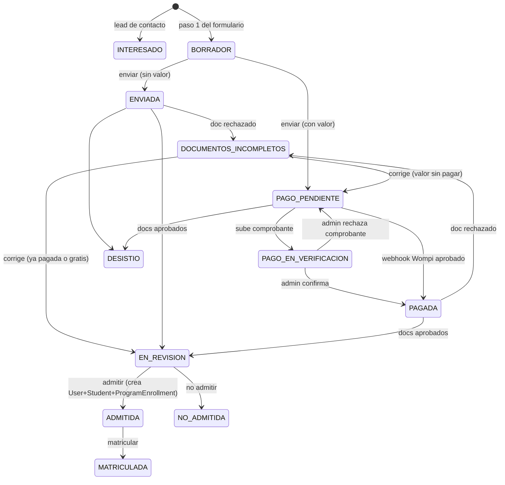

# Sitio web público por institución e inscripciones en línea

Fases 0–6 implementadas en `feature/sitio-web-inscripciones` (nov 2026).
Público objetivo: colegios, ETDH, técnicas, tecnológicas y universidades;
el tipo de institución SOLO cambia textos por defecto — la lógica real sale
del `EducationLevel` de cada programa (§0.1 de la instrucción).

## Arquitectura

- **Renderizado en servidor**: NestJS + plantillas **Eta** + Tailwind compilado
  aparte de la SPA (`backend/tailwind.site.config.js`, script `css:sitio`
  encadenado en `npm run build`; assets copiados a `dist` por `nest-cli.json`).
  El campus (`/login`, `/admin`, `/docente`, `/estudiante`) sigue siendo la SPA.
- **Regla API-first**: la lógica vive en servicios (`public-site/`,
  `admissions/`) que no saben quién los llama; los controladores HTML, los
  endpoints JSON del aspirante y la futura API pública son capas delgadas.
- **Tenant público SOLO por Host** (`PublicTenantService.contexto`):
  X-Tenant-ID y cualquier tenantId del cuerpo se ignoran. Sitio inexistente o
  despublicado ⇒ 404 genérico. Vista previa con token HMAC firmado (1 h).

## Rutas

| Ruta | Qué es |
|---|---|
| `/` | Portada (hero, destacados, convocatorias, beneficios, cifras, CTA). En `ADMISSIONS_ONLY` redirige a `/programas` |
| `/programas` | Oferta con filtros en la URL (`?nivel=&modalidad=&area=&q=`) + directorio por área |
| `/programas/:slug` | Ficha: título/certificado según nivel, SNIES/registro/licencia, pensum público, bloques certificables, articulación "avanzas X%", FAQ, convocatorias |
| `/inscripcion/:slug` | Formulario por pasos (acudiente primero en colegio; valida edad/escolaridad en ETDH) |
| `/aspirante` | Consulta sin cuenta: pide documento+correo → enlace mágico de un solo uso (30 min) |
| `/aspirante/acceso?token=` | Canje del enlace → cookie de sesión HMAC por correo |
| `/aspirante/api/*` | JSON del asistente (borrador, documentos, comprobante, enviar, mis-solicitudes, checkout Wompi) |
| `/contacto` | Datos + formulario que crea un lead (`INTERESADO`) |
| `/privacidad`, `/sitemap.xml`, `/robots.txt` | Por tenant |
| `/public-assets/*` | css/js del sitio (lista blanca) |
| `POST /public/payments/wompi/:tenantSlug` | Webhook de Wompi del TENANT (checksum con su llave de eventos) |

Prefijo global `api/v1` con `exclude` para todas las anteriores
(`backend/src/main.ts`). En `nginx.conf` (contenedor frontend) esas rutas se
proxiean al backend; la raíz es `location = /` exacta para no comerse
`/login`.

## Modelo (migraciones 18–21)

`TenantSite` (hero, secciones, SEO/medición, política de datos,
`institutionType`, `siteMode FULL|ADMISSIONS_ONLY|OFF`,
`paymentInstructions`) · campos públicos en `Program` (slug único por tenant,
`isPublished`, descripciones, área, FAQ, `isNewUntil`) · `AdmissionCall`
(ventana, `rolling` sin cierre, cupos generales y **por grado** en
`targetLevels`, requisitos de edad/escolaridad, documentos requeridos) ·
`Applicant` (consentimiento con fecha/IP/versión, acudiente, UTM
first-touch; **no** es `Student`) · `Application` (código `INS-…`, estados,
enlace mágico como hash+vencimiento, pago) · `ApplicationDocument` (archivo
privado validado por **firma de bytes**) · `ApplicationEvent` (línea de
tiempo) · `OutboxEvent` (eventos de dominio §9) · `TenantPaymentConfig`
(llaves Wompi del tenant cifradas AES-256-GCM con `PAYMENTS_MASTER_KEY`).

## Flujo de estados

Reglas: admitir exige pago confirmado si la convocatoria cobra; respeta
`maxStudents` con error claro; un correo con rol docente/admin no se
convierte en estudiante; `(applicantId, callId)` único ⇒ duplicado = 409 con
el código existente; cupo por grado se cuenta contra `targetLevels`.

## Seguridad (§8)

Antispam honeypot + tiempo mínimo en todo lo público; `ThrottlerGuard` por
endpoint; archivos con lista blanca de MIME verificada por los **primeros
bytes**, nombre aleatorio y almacenamiento privado (descarga solo admin del
tenant o dueño de la sesión); enlace mágico sha256 de un solo uso comparado
en tiempo constante; respuesta genérica sin enumeración; CSP que solo abre
los dominios de la analítica configurada; todo lo configurable se escapa al
renderizar. `tenant-isolation-reviewer` pasó sin hallazgos sobre
`public-site` y `admissions`.

## Medición

Cookie primaria `vu_utm` (first-touch, 90 días) desde la llegada con
utm_*/gclid/fbclid; se pega al `Applicant` al crear el borrador. Evento de
conversión GA4/Google Ads/Meta al ENVIAR. Embudo del admin: interesados →
enviadas → pagadas → admitidas → **matriculadas**, con corte por fuente.

## Lighthouse (18 nov 2026, build producción local)

| Página | Accesibilidad | Best Practices | SEO |
|---|---|---|---|
| `/` | **100** | **100** | **100** |
| `/programas` | **100** | **100** | **100** |
| `/programas/:slug` | **100** | **100** | **100** |

El runner disponible (chrome-devtools MCP) audita en escritorio y no emite
la categoría *performance*; las páginas son SSR con ~16 KB de CSS y ~7 KB de
JS sin fuentes bloqueantes. **Pendiente**: correr `lighthouse --preset=mobile`
en CI para dejar la cifra exacta de rendimiento móvil (meta ≥ 90).

## Correo y variables de entorno

`SMTP_HOST/PORT/SECURE/USER/PASS/FROM` para el correo transaccional (sin
SMTP los correos van al log y el flujo no se cae). `PAYMENTS_MASTER_KEY`
para cifrar las llaves Wompi por tenant.

## Demo

Seed idempotente `backend/prisma/seed-sitio-web.ts`:
`uniprueba` (MIXTA: tecnólogo+especialización con SNIES y diplomado),
`etdhdemo` (técnicos laborales en horas, registro SE, rolling;
admin@etdhdemo.com/Admin123!), `colegiodemo` (preescolar–11° con cupos por
grado y acudiente; admin@colegiodemo.com/Admin123!). En dev:
`http://<slug>.localhost:4000/`.

## Fase 7 — Integración con webs propias (§13)

Tres niveles sobre los MISMOS servicios de admisiones (API-first):

**Nivel 1 — Enlaces y QR**: panel Integraciones genera enlaces listos (oferta,
estado, validación) con `utm_source` y su QR. `siteMode=ADMISSIONS_ONLY`
apaga la portada y deja solo /programas, /inscripcion, /aspirante y /validar
con el logo apuntando a `externalWebsiteUrl`.

**Nivel 2 — Widget**: `
` + `<script src="https://<host-del-tenant>/embed.js">`.
Iframe a `/embed/*` (mismas vistas, layout sin cromo), altura automática y
eventos reenviados a la página madre como CustomEvent
(`virtualuni:application_submitted` con el código, `virtualuni:step`). Solo
carga con `enableEmbed` y la CSP `frame-ancestors` se arma con la lista
blanca del tenant: fuera de ella el navegador bloquea el iframe (verificado
en vivo desde dos orígenes, uno autorizado y uno no). En iframe de tercer
origen la cookie SameSite no viaja: la sesión del asistente va además por
cabecera `X-Asp-Session` con el token firmado que devuelve el borrador.

**Nivel 3 — API `/public/v1`** (docs en `/public/docs`, OpenAPI propia):
llaves por tenant (`pk_`/`sk_` × `live`/`test`, hash en BD, completas UNA
vez, rotar/revocar), tenant resuelto SOLO por la llave, `sk_` con Origin de
navegador rechazada, `pk_` solo lectura y limitada a sus orígenes (CORS),
scopes por endpoint, `Idempotency-Key` obligatoria en POST (misma respuesta
24 h), límites con cabeceras `RateLimit-*`, paginación por cursor, errores
`{error:{code,message}}`. Endpoints: programs, admission-calls (con cupos y
documentos), applications (POST exige la constancia `consent` — la
institución la recoge y responde por ella —, acepta `externalId` y `utm`;
GET con `updatedSince` para sincronizar), documents, leads,
certificates/verify. Las llaves `*_test_` operan datos `isTest` que no tocan
bandeja ni cupos.

**Webhooks salientes** (§13.4): endpoints por tenant (solo HTTPS, SSRF
bloqueado al crear y al enviar), secreto HMAC mostrado una vez, firma
`VirtualUni-Signature: t=<epoch>,v1=hmac(secret, t.cuerpo)` (verificada a
mano en la prueba), dispatcher que consume el outbox cada 15 s, reintentos
con espera creciente (~24 h) y desactivación tras fallos seguidos, evento de
prueba y reenvío manual desde el panel.

**Validación de certificados** (§13.5): al EMITIR un certificado se sella un
código no adivinable; `/validar/:codigo` (página y widget) y la API muestran
lo mínimo (titular, tipo, fecha, estado) con respuesta genérica si no existe.

**Flags de plan** (§13.7): `Tenant.enableEmbed` / `enablePublicApi`; qué plan
incluye cada nivel queda anotado como decisión comercial pendiente.
